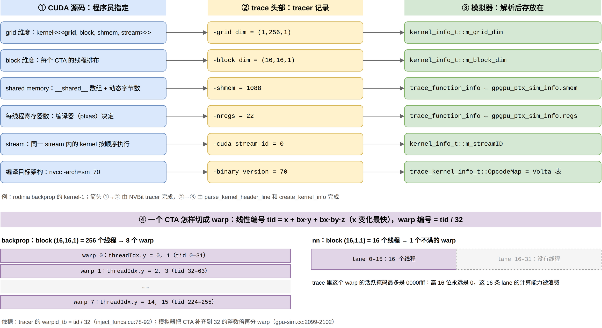
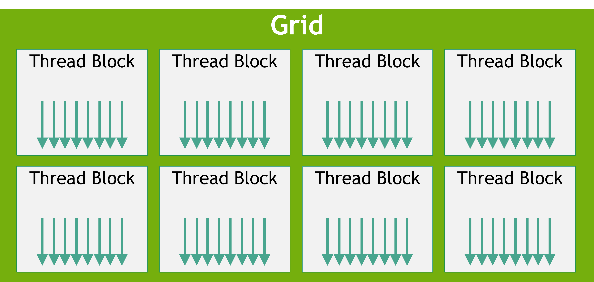
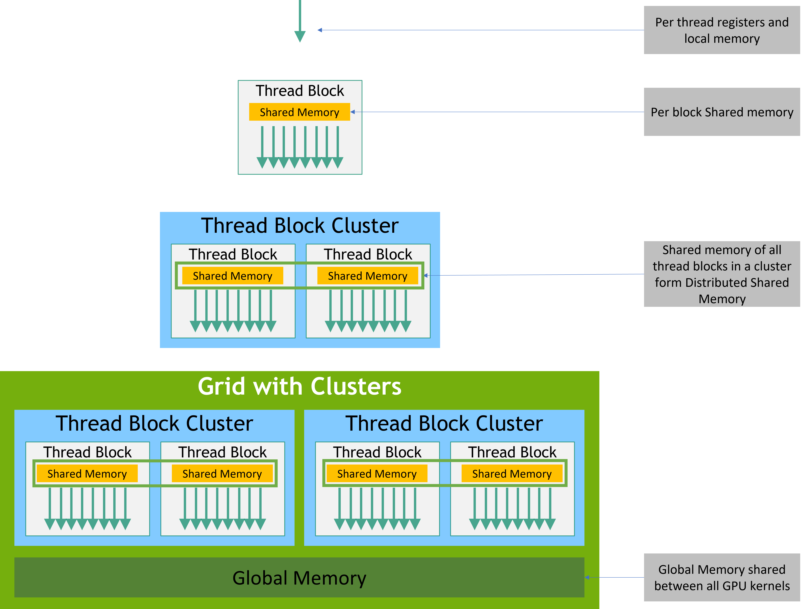

> 本文是 Accel-Sim Framework 的学习文档，随仓库保存；图在 `figs/`，来源见 [`figs/README.md`](figs/README.md)。文中的 `文件:行号` 都是相对本仓库的链接，点击可直接跳到对应代码行。

# 00-1 CUDA 编程模型：线程层次与内存空间

> 属于 [00 GPU 基础：编程模型与硬件全貌总览](00-0-gpu-basics-overview.md)。标 ✅ 的是直接从代码、配置或 trace 读出的事实，标 ❓ 的是待核实。概念部分的出处是教材（Aamodt 等，2018）和 [CUDA C++ Programming Guide](https://docs.nvidia.com/cuda/cuda-c-programming-guide/)。

本篇回答一个问题：**启动一个 kernel 时，程序员到底告诉了 GPU 什么？这些信息怎样一路传进模拟器？** 先讲概念（线程层次、内存空间、stream），再看 Accel-Sim 用哪些字段装下它们，最后用本地 `hw_run/` 里 10 个 rodinia kernel 的真实 trace 验证。



图分两部分。上半部分每一行是一项启动信息，从左到右依次是：程序员在源码里怎么指定 → tracer 在 trace 头部写成什么样 → 模拟器解析后存进哪个字段。下半部分 ④ 是一个 CTA 怎样被切成若干个 warp。后面各节按这张图的顺序展开。

---

## 1. 概念：kernel、grid、block（CTA）、warp、thread

### 1.1 一个 CUDA 程序的样子

GPU 程序从 CPU 开始执行。CPU 端的代码（叫 **host** 代码）做三件事：在 GPU 显存里分配空间、把输入数据拷进去、启动一个 **kernel**（在 GPU 上运行的函数）。这就是教材 §2.1（p.9）开头描述的流程。下面是一个向量加法的例子：

```cuda
__global__ void vadd(int n, const float *a, const float *b, float *c) {
  int i = blockIdx.x * blockDim.x + threadIdx.x;   // 我是第几个线程
  if (i < n) c[i] = a[i] + b[i];                   // 每个线程只算一个元素
}

int main() {
  // ... 省略：host 端分配并初始化 h_a、h_b
  cudaMalloc(&d_a, n * sizeof(float));             // 在 GPU 显存里分配
  cudaMemcpy(d_a, h_a, n * sizeof(float), cudaMemcpyHostToDevice);
  // ... d_b、d_c 同理
  vadd<<<(n + 255) / 256, 256>>>(n, d_a, d_b, d_c); // 启动 kernel
  cudaMemcpy(h_c, d_c, n * sizeof(float), cudaMemcpyDeviceToHost);
}
```

和 CPU 程序对比：CPU 版本会写一个 `for (i = 0; i < n; i++)` 循环；CUDA 版本把**循环的每一次迭代变成一个独立的线程**。程序员只写"一个线程做什么"，同时启动成千上万个线程。每个线程用内置变量 `threadIdx`、`blockIdx`、`blockDim` 算出自己的编号，再决定处理哪一份数据。

### 1.2 线程层次

`<<<grid, block>>>` 这对尖括号就是 **kernel 启动配置**。它把线程组织成两层：



*图源：NVIDIA CUDA C++ Programming Guide。一个 grid 由若干 thread block 组成，每个 block 里有若干线程（箭头）。*

| 层次 | 是什么 | 程序员怎么指定 | 关键性质 |
| --- | --- | --- | --- |
| **grid** | 一次 kernel 启动的全部线程 | `<<<grid, …>>>` 的第一个参数，`dim3`（x, y, z） | 不同 block 之间**没有执行顺序保证**，也不能用 barrier 同步 |
| **thread block**（NVIDIA 硬件文档里叫 **CTA**，Cooperative Thread Array） | 一组会一起被放到**同一个 SM** 上执行的线程 | 第二个参数，`dim3`；当前 GPU 上一个 block 最多 1024 个线程 | block 内的线程能共享 shared memory，能用 `__syncthreads()` 做 barrier |
| **thread** | 一个标量线程 | 由 grid × block 自动展开 | 每个线程有自己的寄存器和 local memory |

教材 §2.1（p.12）还提到第三层 **warp**：硬件把一个 block 里每 32 个线程编成一组，锁步执行同一条指令（AMD 叫 wavefront，64 个线程）。warp 不出现在 `<<<>>>` 里，但会实实在在地影响性能。00-2 会专门讲 warp 怎样执行。

为什么要分 block 这一层？

- **可扩展**：block 之间互不依赖，硬件可以按任意顺序、在任意个 SM 上调度它们。同一份程序在 80 个 SM 的 V100 和 132 个 SM 的 H100 上都能跑，SM 多就同时多跑几个 block。
- **局部协作**：需要互相通信的线程放进同一个 block，它们在同一个 SM 上，可以用片上的 shared memory 交换数据、用 barrier 同步，代价很小。

和 CPU 对比：block 有点像 OpenMP `parallel for` 切出来的一个 chunk，但 GPU 线程极其轻量。线程的创建和切换都由硬件完成，不经过操作系统；一个 SM 上同时驻留上千个线程是常态（QV100 配置里每个 SM 最多 2048 个线程，见 §3.4）。

### 1.3 内存空间



*图源：NVIDIA CUDA C++ Programming Guide。图中的 Thread Block Cluster 是 Hopper 新增的一层，第 09 阶段再讲，这里先跳过。*

程序员能看到的内存分成几种"空间"。它们的区别在于**谁能看见、活多久**：

| 空间 | 谁能看见 | 生命周期 | 源码里怎么用 | 物理上大致在哪 |
| --- | --- | --- | --- | --- |
| 寄存器 | 单个线程 | 线程 | 普通局部变量（编译器分配） | SM 内的寄存器堆 |
| local | 单个线程 | 线程 | 放不进寄存器的局部数组、寄存器溢出（spill） | 显存，经 L1/L2 缓存 |
| shared | 同一个 block 的线程 | block | `__shared__` 数组；或启动时的第 3 个参数（动态大小） | SM 内的片上 SRAM |
| global | 所有线程，以及 host（通过 `cudaMemcpy`） | 应用程序 | `cudaMalloc` 出来的指针 | 显存，经 L1/L2 缓存 |
| constant | 所有线程，只读 | 应用程序 | `__constant__` 变量 | 显存，经专用的常量 cache |
| param | 所有线程，只读 | kernel | kernel 的参数（上例中的 `n, d_a, d_b, d_c`） | ❓ 见 §2.3 |

教材 §2.1（p.13）强调 shared memory 是"软件管理的 cache"：每个 SM 只有一块，由驻留在这个 SM 上的所有 block 分着用。global memory 是 block 之间唯一的通信途径，但比 shared memory 慢、耗能也高。

### 1.4 stream

`<<<grid, block, shmem, stream>>>` 的第 4 个参数是 **stream**，可以理解成一条命令队列。同一个 stream 里的 kernel 和 memcpy **按提交顺序**依次执行；不同 stream 里的命令可以并发。不写时默认用 stream 0。

---

## 2. 代码：这些信息怎样进入模拟器

### 2.1 trace 头部：tracer 记下了哪些启动信息

NVBit tracer 在真实 GPU 上运行程序时，每拦截到一次 kernel 启动，就写一个 `kernel-N.traceg` 文件，开头是一段以 `-` 开头的头部。下面是本地 backprop 第一个 kernel 的头部 ✅（文件在 `hw_run/rodinia_2.0-ft/11.0/backprop-rodinia-2.0-ft/<参数目录>/traces/kernel-1.traceg`；`hw_run/` 不入库，来自 Accel-Sim 公开的 trace 包）：

```text
-kernel name = _Z22bpnn_layerforward_CUDAPfS_S_S_ii
-kernel id = 1
-grid dim = (1,256,1)
-block dim = (16,16,1)
-shmem = 1088
-nregs = 22
-binary version = 70
-cuda stream id = 0
-shmem base_addr = 0x00007f70c3000000
-local mem base_addr = 0x00007f70c5000000
-nvbit version = 1.4
-accelsim tracer version = 3
```

和 §1 的概念对应：`grid dim` 和 `block dim` 就是 `<<<>>>` 的前两个参数；`shmem` 是每个 block 用的 shared memory 字节数；`nregs` 是编译器给每个线程分配的寄存器数；`cuda stream id` 是 stream。`binary version = 70` 表示这段代码是为 SM 7.0（Volta）编译的，00-4 会讲。

### 2.2 解析：从文本到 `kernel_trace_t`，再到 `kernel_info_t`

**第一步：逐行解析头部。** [`parse_kernel_header_line`](../../gpu-simulator/trace-parser/trace_parser.cc#L444-L492) 按每行开头的两个单词分派，用 `sscanf` 把数值填进 [`kernel_trace_t`](../../gpu-simulator/trace-parser/trace_parser.h#L169-L189) ✅：

摘录（[`trace_parser.cc:459-466`](../../gpu-simulator/trace-parser/trace_parser.cc#L459-L466)）✅：

```cpp
  } else if (string1 == "grid" && string2 == "dim") {
    sscanf(line.c_str(), "-grid dim = (%d,%d,%d)", &kernel_info->grid_dim_x,
           &kernel_info->grid_dim_y, &kernel_info->grid_dim_z);
  } else if (string1 == "block" && string2 == "dim") {
    sscanf(line.c_str(), "-block dim = (%d,%d,%d)", &kernel_info->tb_dim_x,
           &kernel_info->tb_dim_y, &kernel_info->tb_dim_z);
  } else if (string1 == "shmem" && string2 == "=") {
    sscanf(line.c_str(), "-shmem = %d", &kernel_info->shmem);
```

[`parse_kernel_info`](../../gpu-simulator/trace-parser/trace_parser.cc#L495-L531) 读到第一行 `#` 就停下：头部之后才是逐条指令的 trace，要等 CTA 真正上 SM 时才读（第 03 阶段）✅。

**第二步：装进 GPGPU-Sim 的 kernel 对象。** [`create_kernel_info`](../../gpu-simulator/accel-sim.cc#L174-L192) 把 `kernel_trace_t` 拆开 ✅：

摘录（[`accel-sim.cc:178-189`](../../gpu-simulator/accel-sim.cc#L178-L189)）✅：

```cpp
  gpgpu_ptx_sim_info info;
  info.smem = kernel_trace_info->shmem;      // shared memory 字节数
  info.regs = kernel_trace_info->nregs;      // 每线程寄存器数
  dim3 gridDim(kernel_trace_info->grid_dim_x, kernel_trace_info->grid_dim_y,
               kernel_trace_info->grid_dim_z);
  dim3 blockDim(kernel_trace_info->tb_dim_x, kernel_trace_info->tb_dim_y,
                kernel_trace_info->tb_dim_z);
  trace_function_info *function_info =
      new trace_function_info(info, m_gpgpu_context);
  function_info->set_name(kernel_trace_info->kernel_name.c_str());
  trace_kernel_info_t *kernel_info = new trace_kernel_info_t(
      gridDim, blockDim, function_info, parser, config, kernel_trace_info);
```

信息在这里分成了两路：

| 信息 | 存在哪 | 代码 |
| --- | --- | --- |
| grid、block 维度 | `kernel_info_t::m_grid_dim`、`m_block_dim` | [`abstract_hardware_model.h:629-630`](../../gpu-simulator/gpgpu-sim/src/abstract_hardware_model.h#L629-L630) ✅ |
| stream | `kernel_info_t::m_streamID`，由 `trace_kernel_info_t` 构造时传入 `cuda_stream_id` | [`abstract_hardware_model.h:623`](../../gpu-simulator/gpgpu-sim/src/abstract_hardware_model.h#L623)、[`trace_driven.cc:191-192`](../../gpu-simulator/trace-driven/trace_driven.cc#L191-L192) ✅ |
| shared memory、寄存器数 | `trace_function_info` 里的 `gpgpu_ptx_sim_info`（描述"这个函数"而不是"这次启动"） | [`accel-sim.cc:179-180`](../../gpu-simulator/accel-sim.cc#L179-L180) ✅ |
| binary version | 选出这次启动用哪张 SASS opcode 表 | [`trace_driven.cc:198-219`](../../gpu-simulator/trace-driven/trace_driven.cc#L198-L219) ✅ |

`kernel_info_t` 是 GPGPU-Sim 里"一次 kernel 启动"的抽象，PTX 模式和 trace 模式共用它。`trace_kernel_info_t` 是 Accel-Sim 的子类，多了 trace 文件句柄和 opcode 表。第 02 阶段会讲完整的继承关系。shared memory 和寄存器数主要用于决定一个 SM 能同时放下几个 CTA（occupancy），第 03 阶段读。

### 2.3 线程编号：从三维坐标到 warp

`kernel_info_t` 提供了两个派生量 ✅（[`abstract_hardware_model.h:550-556`](../../gpu-simulator/gpgpu-sim/src/abstract_hardware_model.h#L550-L556)）：

```cpp
  size_t num_blocks() const { return m_grid_dim.x * m_grid_dim.y * m_grid_dim.z; }
  size_t threads_per_cta() const { return m_block_dim.x * m_block_dim.y * m_block_dim.z; }
```

三维坐标怎样排成一维？GPGPU-Sim 遍历 CTA 和线程时都用 [`increment_x_then_y_then_z`](../../gpu-simulator/gpgpu-sim/src/gpgpu-sim/gpu-sim.cc#L836-L846)：先加 x，x 溢出才进位到 y，再进位到 z ✅。线程的一维编号是 [`get_next_thread_id`](../../gpu-simulator/gpgpu-sim/src/abstract_hardware_model.h#L581-L584) 里的 `x + bx·y + bx·by·z` ✅。

warp 就是把一维编号每 32 个切一刀。trace 里每段指令前的 `warp = N`，是 tracer 在 GPU 上按同样的公式算出来的 ✅（[`inject_funcs.cu:78-92`](../../util/tracer_nvbit/tracer_tool/inject_funcs.cu#L78-L92)）：

```cpp
  int uniqe_threadId = threadIdx.z * blockDim.y * blockDim.x +
                       threadIdx.y * blockDim.x + threadIdx.x;
  // ...
  trace.warpid_tb = uniqe_threadId / 32;
```

模拟器把 CTA 放上 SM 时，先把线程数**向上补齐到 32 的整数倍**再分配硬件线程槽（[`gpu-sim.cc:2099-2102`](../../gpu-simulator/gpgpu-sim/src/gpgpu-sim/gpu-sim.cc#L2099-L2102)），每个硬件线程的 warp 号是 `i / warp_size`（[`gpu-sim.cc:2133`](../../gpu-simulator/gpgpu-sim/src/gpgpu-sim/gpu-sim.cc#L2133)）✅。trace 模式下 [`trace_shader_core_ctx::init_warps`](../../gpu-simulator/trace-driven/trace_driven.cc#L1019-L1032) 用同样的方法算出这个 CTA 占了哪几个 warp，再把 trace 里的各个 warp 依次绑上去 ✅。

所以：

- block (16,16,1) 有 256 个线程，正好 8 个 warp。warp k 包含 `threadIdx.y = 2k` 和 `2k+1` 这两行。
- block (16,1,1) 只有 16 个线程，也要占一整个 warp，高 16 个 lane 永远空着。这就是图 ④ 右半部分。

### 2.4 内存空间在 SASS 和模拟器里的样子

源码里的内存空间，编译成 SASS 后**大多直接体现在 opcode 上**。[`trace_warp_inst_t::parse_from_trace_struct`](../../gpu-simulator/trace-driven/trace_driven.cc#L253) 按 opcode 给每条访存指令标上 GPGPU-Sim 的空间类型（枚举定义在 [`abstract_hardware_model.h:71-86`](../../gpu-simulator/gpgpu-sim/src/abstract_hardware_model.h#L71-L86)）✅：

| 空间 | SASS opcode | 模拟器里的类型 | 代码 |
| --- | --- | --- | --- |
| global | `LDG` / `STG` / `ATOMG` / `RED` / `ATOM` | `global_space` | [`trace_driven.cc:384-431`](../../gpu-simulator/trace-driven/trace_driven.cc#L384-L431) ✅ |
| local | `LDL` / `STL` | `local_space` | 同上（与 `LDG`/`STG` 共用 case，按 opcode 区分） ✅ |
| shared | `LDS` / `STS` / `ATOMS` / `LDSM` | `shared_space` | [`trace_driven.cc:432-456`](../../gpu-simulator/trace-driven/trace_driven.cc#L432-L456) ✅ |
| constant | `LDC` | `const_space` | [`trace_driven.cc:377-383`](../../gpu-simulator/trace-driven/trace_driven.cc#L377-L383) ✅ |
| 由地址决定 | 通用的 `LD` / `ST` | 落在 `[shmem_base, local_base)` 是 shared，落在 local 窗口里是 local，其余是 global | [`trace_driven.cc:457-494`](../../gpu-simulator/trace-driven/trace_driven.cc#L457-L494) ✅ |

最后一行就是 trace 头里两个 `base_addr` 的用途：通用的 `LD`/`ST` 指令只给出一个地址，模拟器用这两个窗口判断它属于哪个空间 ✅。local 窗口的大小是 [`LOCAL_MEM_SIZE_MAX`](../../gpu-simulator/gpgpu-sim/src/abstract_hardware_model.h#L798) = 16 KB ✅。

param 空间在枚举里有 `param_space_kernel`，`kernel_info_t` 也有 [`m_param_mem`](../../gpu-simulator/gpgpu-sim/src/abstract_hardware_model.h#L637)，但上表里没有哪条 SASS 指令被标成 param。我的推测是：SASS 把 kernel 参数放在常量 bank `c[0x0][...]` 里，指令直接以它为操作数读取，不需要单独的访存指令；而 trace 不记录这类操作数，所以 trace 模式里看不到参数访问 ❓。00-5 用 `cuobjdump -sass` 看一下真实的 SASS 就能确认。

### 2.5 stream 与 memcpy

kernel 之外，host 端的 `cudaMemcpy` 也会被记下来。`kernelslist.g` 按时间顺序列出所有命令，backprop 的开头是 ✅：

```text
MemcpyHtoD,0x00007f7091700000,16388
MemcpyHtoD,0x00007f7091704400,278596
kernel-1.traceg
```

- `MemcpyHtoD` 行在 [`parse_commandlist`](../../gpu-simulator/accel-sim.cc#L98-L104) 里交给 [`perf_memcpy_to_gpu`](../../gpu-simulator/gpgpu-sim/src/gpgpu-sim/gpu-sim.cc#L2531-L2551)。它不搬运任何数据（trace 模式不需要数据值），而是把拷贝范围按 32 字节切开，对每一段调用 [`force_l2_tag_update`](../../gpu-simulator/gpgpu-sim/src/gpgpu-sim/l2cache.cc#L109-L120)，直接把这些地址的 tag 写进 L2，相当于假设刚拷进来的数据已经在 L2 里 ✅。这个行为由 `-gpgpu_perf_sim_memcpy` 控制（"Fill the L2 cache on memcpy"，[`gpu-sim.cc:241`](../../gpu-simulator/gpgpu-sim/src/gpgpu-sim/gpu-sim.cc#L241)），QV100 配置里是打开的（[`gpgpusim.config:168`](../../gpu-simulator/gpgpu-sim/configs/tested-cfgs/SM7_QV100/gpgpusim.config#L168)）✅。
- kernel 行在 [`simulation_loop`](../../gpu-simulator/accel-sim.cc#L53-L68) 里发射。发射前检查 `busy_streams`：**同一个 stream 上已经有 kernel 在跑，就不发射**，这正好实现了"同一 stream 内按顺序执行"的语义 ✅。kernel 跑完后在 [`cleanup`](../../gpu-simulator/accel-sim.cc#L129-L132) 里把这个 stream 从 `busy_streams` 中删掉 ✅。

---

## 3. 验证：用本地的 10 个 rodinia kernel 对一遍

### 3.1 启动配置一览

本地 `hw_run/rodinia_2.0-ft/11.0/` 下每个程序第一个 kernel 的头部 ✅：

| 程序 | grid dim | block dim | 每 block 线程数 | shmem（字节） | nregs |
| --- | --- | --- | --- | --- | --- |
| backprop | (1,256,1) | (16,16,1) | 256 | 1088 | 22 |
| bfs | (8,1,1) | (512,1,1) | 512 | 0 | 21 |
| heartwall | (51,1,1) | (512,1,1) | 512 | 11872 | 43 |
| hotspot | (8,8,1) | (16,16,1) | 256 | 3072 | 35 |
| lud | (1,1,1) | (16,1,1) | 16 | 1024 | 32 |
| nn | (938,1,1) | (16,1,1) | 16 | 0 | 21 |
| nw | (1,1,1) | (16,1,1) | 16 | 2180 | 32 |
| pathfinder | (5,1,1) | (256,1,1) | 256 | 2048 | 18 |
| srad_v2 | (8,8,1) | (16,16,1) | 256 | 6144 | 22 |
| streamcluster | (2,1,1) | (512,1,1) | 512 | 64 | 32 |

能看出几件事：二维的 grid 和 block 很常见（backprop、hotspot、srad_v2）；每个线程用的寄存器在 18–43 个之间；有 3 个程序的 block 只有 16 个线程，不满一个 warp。

### 3.2 block 数和 warp 数对得上吗

数一下 trace 文件里 `thread block =` 和 `warp =` 行出现的次数 ✅：

| 程序 | grid 算出的 block 数 | trace 里的 block 数 | 每 block 的 warp 数（算出 / trace） |
| --- | --- | --- | --- |
| streamcluster | 2 | 2 | 512/32 = 16 / 16 |
| backprop | 1×256 = 256 | 256 | 256/32 = 8 / 8 |
| nn | 938 | 938 | ⌈16/32⌉ = 1 / 1 |

全部吻合，说明 §2.3 的切分规则和 tracer 的记录一致。

nn 那个不满的 warp，第一个 block 里各条指令的活跃掩码统计如下 ✅：

| 掩码 | 指令条数 |
| --- | --- |
| `0000ffff` | 105 |
| `0000fbff` | 10 |
| `0000c2f0` | 5 |
| `00000000` | 10 |

高 16 位从来没有出现过 1，正对应"lane 16–31 没有线程"。`0000fbff` 和 `0000c2f0` 是部分线程走了不同分支（分支发散），`00000000` 的含义 ❓。这两点都留给 00-2。

### 3.3 一条访存指令属于哪个空间

backprop 第一个 block、warp 0 里的几条访存指令 ✅（行格式：PC、活跃掩码、目的寄存器数和寄存器、opcode、源寄存器数和寄存器、访存宽度、地址压缩格式、地址；后面的 delta 列表截断了）：

```text
0090 00010001 1 R12 LDG.E.SYS 1 R8 4 2 0x7f7091700004 -140104273231868 0 0 ...
0150 00010001 0 STS 2 R7 R12 4 2 0x0 0 0 ...
0170 ffffffff 0 BAR.SYNC 0 0
03d0 ffffffff 0 STS 2 R9 R14 4 1 0x40 4
```

- `LDG` 的地址 `0x7f7091700004` 是一个很大的虚拟地址，它正好落在 `kernelslist.g` 第一行 `MemcpyHtoD,0x00007f7091700000,16388` 拷进去的那块缓冲区里：host 拷进 global memory 的数据，被 kernel 用 `LDG` 读出来 ✅。
- `STS` 的地址是 `0x0`、`0x40` 这样的小数：shared memory 指令给出的是 block 内 shared 空间的偏移，不是全局地址 ✅。
- `BAR.SYNC` 就是源码里的 `__syncthreads()` ❓（00-5 会对照源码确认）。

再统计这 10 个程序（每个程序最多前 3 个 kernel）里不同空间的指令 ✅：只有 heartwall 用了 `LDC`（8160 条），没有任何程序用 `LDL`/`STL`（没有寄存器溢出），也没有原子操作。backprop 第一个 block（8 个 warp）里 `LDS` 96 条、`STS` 56 条、`BAR` 64 条，远多于 `LDG` 16 条、`STG` 16 条，说明它把数据读进 shared memory 后反复使用，正是 §1.3 说的"软件管理的 cache"。

### 3.4 硬件上限在配置里

程序员能启动多大的 grid 和 block 是编程模型的事；**一个 SM 同时能放多少**是硬件的事，写在 GPU 配置里。QV100 的配置 ✅：

| 参数 | 值 | 含义 |
| --- | --- | --- |
| [`-gpgpu_shader_core_pipeline`](../../gpu-simulator/gpgpu-sim/configs/tested-cfgs/SM7_QV100/gpgpusim.config#L82) | `2048:32` | 每个 SM 最多 2048 个线程，warp 大小 32（格式见 [`gpu-sim.cc:360-362`](../../gpu-simulator/gpgpu-sim/src/gpgpu-sim/gpu-sim.cc#L360-L362)） |
| [`-gpgpu_shader_cta`](../../gpu-simulator/gpgpu-sim/configs/tested-cfgs/SM7_QV100/gpgpusim.config#L83) | `32` | 每个 SM 最多同时 32 个 CTA |
| [`-gpgpu_shader_registers`](../../gpu-simulator/gpgpu-sim/configs/tested-cfgs/SM7_QV100/gpgpusim.config#L77) | `65536` | 每个 SM 的寄存器总数 |
| [`-gpgpu_shmem_size`](../../gpu-simulator/gpgpu-sim/configs/tested-cfgs/SM7_QV100/gpgpusim.config#L159) | `98304` | 每个 SM 的 shared memory（96 KB） |

trace 头里的 `nregs` 和 `shmem` 就是拿来和这些上限比的。比如 backprop 每个 block 需要 256 × 22 = 5632 个寄存器、1088 字节 shared memory。一个 SM 能同时放几个这样的 block，由线程、寄存器、shared memory、CTA 槽里最紧的那一项决定。这个计算在第 03 阶段读。

---

## 精读结论（2026-10-26）：启动一个 kernel 时，程序员给出的信息只有六项，Accel-Sim 把它们从 trace 头读进 `kernel_info_t` 和 `trace_function_info` ✅

| 程序员给出的 | trace 头 | 模拟器字段 | 用途 |
| --- | --- | --- | --- |
| grid 维度 | `-grid dim` | `kernel_info_t::m_grid_dim` | CTA 总数，按 x→y→z 的顺序逐个派发 |
| block 维度 | `-block dim` | `kernel_info_t::m_block_dim` | 每个 CTA 的线程数，按 `tid/32` 切成 warp，不满 32 的补齐 |
| shared memory | `-shmem` | `gpgpu_ptx_sim_info.smem` | 第 03 阶段的 occupancy 计算 |
| 寄存器数（编译器决定） | `-nregs` | `gpgpu_ptx_sim_info.regs` | 同上 |
| stream | `-cuda stream id` | `kernel_info_t::m_streamID` | `busy_streams` 保证同一 stream 内串行 |
| 编译目标架构 | `-binary version` | `trace_kernel_info_t::OpcodeMap` | 选 SASS opcode 表 |

内存空间在 SASS 层大多直接由 opcode 区分（`LDG`/`LDS`/`LDL`/`LDC`）；只有通用的 `LD`/`ST` 要靠 trace 头里的 `shmem base_addr` 和 `local mem base_addr` 按地址判断。host 端的 `cudaMemcpy` 以 `MemcpyHtoD` 命令出现在 `kernelslist.g` 里，模拟器不搬数据，只把这些地址预先填进 L2 的 tag（`-gpgpu_perf_sim_memcpy 1`）。

**对教材的补充：** 教材 §2.1 只讲了 grid/CTA/warp、shared 和 global。local、constant、param 这几个空间，以及 SASS 层用不同 opcode 区分空间、通用 `LD`/`ST` 按地址窗口判断，都是在这份代码和 trace 里读到的。

❓ 待核实：

- kernel 参数在 SASS 里是否通过常量 bank `c[0x0][...]` 直接作为操作数读取，因而 trace 里看不到参数访问。核实方法：00-5 用 `cuobjdump -sass` 看自己写的 kernel。
- backprop 的 `shmem = 1088` 是否正好等于源码里的 `__shared__ float input_node[16]` 加 `weight_matrix[16][16]`（64 + 1024 字节）。需要 gpu-app-collection 里的 rodinia 源码，本地还没有 clone。
- `BAR.SYNC` 是否一一对应源码里的 `__syncthreads()`；活跃掩码为 `00000000` 的指令是什么含义。分别在 00-5 和 00-2 核实。
